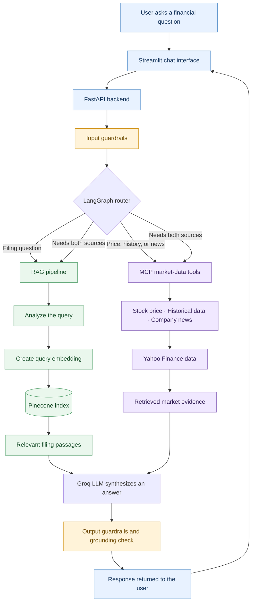

# FinSight AI

### AI-Powered Financial Research Assistant

**Ask questions about company filings. Explore market data. Review
evidence-backed answers.**

[GitHub Repository](https://github.com/Kushalraju098/FinSight_AI) ·
[Backend API
Docs](https://finsight-backend-626144383400.northamerica-northeast2.run.app/docs)

------------------------------------------------------------------------

## Overview

FinSight AI is a financial research application that brings
**retrieval-augmented generation (RAG)**, **LangGraph workflow
orchestration**, and **Model Context Protocol (MCP) tools** into one
conversational interface.

Users can ask questions about supported companies' indexed SEC filings,
request current or historical stock-price data, and retrieve company
news. A FastAPI backend coordinates the request, while a Streamlit
frontend provides the chat experience. Input checks and an
evidence-grounding evaluation are included to help reduce unsafe inputs
and unsupported answers.

> **Project status:** Deployed portfolio project. Features and data
> availability depend on the configured model providers, Pinecone index,
> and external market-data sources.

> **Disclaimer:** FinSight AI is for educational and informational
> research only. It is not financial or investment advice. Verify
> material claims against original filings and trusted data sources
> before making decisions.

## Key capabilities

-   **SEC filing Q&A:** Retrieve relevant passages from the indexed
    financial-document corpus using semantic embeddings and Pinecone.
-   **Query analysis:** Convert a natural-language filing question into
    a structured query containing the company, filing timeframe, and
    retrieval query.
-   **Market-data tools:** Retrieve a stock's latest available price,
    historical OHLCV data, and company news through MCP tools.
-   **Conditional workflow routing:** Use LangGraph to route questions
    to the filing-retrieval path, market-data path, or both when
    required.
-   **Evidence-based synthesis:** Generate a concise response using the
    question and the evidence collected by the workflow.
-   **Input and output checks:** Apply input guardrails and evaluate
    whether factual claims are supported by the retrieved RAG or MCP
    evidence.
-   **Web interface and API:** Use Streamlit for the user experience and
    FastAPI for the `/chat` endpoint and interactive API documentation.
-   **Cloud deployment:** Run the frontend and backend as separate
    Google Cloud Run services.

## Architecture

FinSight AI has two ways to gather evidence: **RAG** searches indexed SEC filing content, while **MCP tools** retrieve market prices, historical data, and company news. LangGraph routes the question to the relevant path, and the available evidence is used to prepare and check the answer.



**How to read the diagram**

- **RAG path:** analyzes the filing question, embeds it, and retrieves relevant passages from Pinecone.
- **MCP path:** calls tools for stock prices, historical market data, or company news.
- **Answer generation:** the Groq-backed LLM uses the evidence returned by the selected path or paths.
- **Output checks:** the response is processed by output guardrails, including a grounding evaluation, before it is returned. These checks reduce risk but do not guarantee correctness.

### Request lifecycle

1. The user submits a question through Streamlit.
2. FastAPI validates the request and runs the configured input checks.
3. LangGraph routes the request to RAG, MCP, or both paths.
4. RAG analyzes the query and retrieves relevant records from the Pinecone index; MCP invokes the available market-data tools.
5. The synthesis step uses the question and available evidence to draft an answer.
6. Output guardrails sanitize the response for detected PII and evaluate grounding against the evidence supplied to the evaluator.
7. FastAPI returns the response to the frontend.

**Grounding note:** The grounding evaluator checks an answer against the evidence passed to it. This is a risk-reduction measure, not a guarantee that every answer is correct or that every possible failure mode is detected.

## Technology stack

  -----------------------------------------------------------------------
  Component                           Technology
  ----------------------------------- -----------------------------------
  Language                           : Python

  Frontend                           : Streamlit

  Backend API                        : FastAPI, Uvicorn

  Workflow orchestration             : LangGraph

  LLM integration                    : LangChain, Groq API

  Grounding evaluation               : Google Gemini through
                                      `langchain-google-genai`

  Embeddings                         : Sentence Transformers,
                                      `all-mpnet-base-v2`

  Vector database                    : Pinecone

  Tool protocol                      : Model Context Protocol (MCP),
                                      FastMCP

  Market-data access                 : `yfinance`

  News feed parsing                  : `feedparser` in the RSS-based
                                      implementation

  Deployment                         : Docker and Google Cloud Run
  -----------------------------------------------------------------------

The workflow and query-analysis code currently configures Groq with
`openai/gpt-oss-20b`. The output-grounding evaluator currently
configures Gemini with `gemini-3.5-flash`. Model availability and
provider settings may change; check the source configuration before
deploying.

## Supported companies and tools

### Filing retrieval

The query schema currently supports these tickers:

  Ticker    Company
  --------- -----------
  `AAPL`    Apple
  `MSFT`    Microsoft
  `AMZN`    Amazon
  `NVDA`    NVIDIA
  `GOOGL`   Alphabet

Filing answers depend on the documents already indexed in the configured
Pinecone index. A filing that has not been ingested and indexed cannot
be assumed to be available to the RAG pipeline.

### MCP tools

  ---------------------------------------------------------------------------
  Tool                        Purpose                 Example prompt
  --------------------------- ----------------------- -----------------------
  `get_stock_price`           Retrieve the latest     "What is NVIDIA's
                              available price for a   latest available stock
                              ticker                  price?"

  `get_stock_price_history`   Retrieve historical     "Show Microsoft's stock
                              open, high, low, close, history for the last
                              and volume values       three months."

  `get_stock_news`            Retrieve recent news    "Find recent news about
                              associated with a       Apple."
                              ticker                  
  ---------------------------------------------------------------------------

Market-data availability, timestamps, coverage, and freshness depend on
the upstream provider. Treat retrieved data as provider-supplied
information, not a guaranteed real-time exchange feed.

## Repository structure

The following are the main application modules:

``` text
FinSight_AI/
├── main.py                 # FastAPI application and /chat endpoint
├── streamlit_app.py        # Streamlit frontend
├── graph.py                # LangGraph routing, RAG/MCP nodes, synthesis
├── rag.py                  # Query analysis, embeddings, Pinecone retrieval
├── mcp_server.py           # FastMCP market-data tools
├── mcp_client.py            # MCP client utilities
├── input_guardrails.py     # Input checks and PII-related handling
├── output_guardrails.py    # Response sanitization and grounding evaluation
├── evaluate.py             # Evaluation runner
├── evaluation_dataset.json # Evaluation cases
└── README.md               # Project documentation
```

The repository may contain additional deployment, ingestion, evaluation,
or data files. Refer to the current branch for the complete file list.

## Getting started locally

### Prerequisites

-   Python version compatible with the project's dependency lockfile
-   [`uv`](https://docs.astral.sh/uv/) if using the repository's
    `pyproject.toml` and `uv.lock`
-   A Groq API key
-   A Google Gemini API key with access to the configured grounding
    model
-   A Pinecone API key and an existing, populated index named `finsight`
-   Network access to the configured external data providers

The current embedding model, `all-mpnet-base-v2`, produces
768-dimensional vectors. The Pinecone index must use vectors compatible
with the model and the data-ingestion pipeline used to populate it.

### 1. Clone the repository

``` bash
git clone https://github.com/Kushalraju098/FinSight_AI.git
cd FinSight_AI
```

### 2. Configure credentials

Create a `.env` file in the project root and provide the credentials
required by the code:

``` dotenv
GROQ_API_KEY=your_groq_api_key
GOOGLE_API_KEY=your_google_gemini_api_key
PINECONE_API_KEY=your_pinecone_api_key
```

These are example variable names for the corresponding integrations.
Confirm the expected environment-variable names in the installed
versions of the provider libraries and the current project source before
running. Never commit a `.env` file or real credentials to source
control.

### 3. Install dependencies

If the repository's current branch contains `pyproject.toml` and
`uv.lock`:

``` bash
uv sync
```

If dependency-management files differ on the current branch, follow the
installation instructions defined by those files.

### 4. Start the backend

From the repository root:

``` bash
uv run uvicorn main:app --reload --host 127.0.0.1 --port 8000
```

Open the interactive API documentation at:

<http://127.0.0.1:8000/docs>

### 5. Start the frontend

In a second terminal, from the repository root:

``` bash
API_BASE_URL=http://127.0.0.1:8000 uv run streamlit run streamlit_app.py --server.port 8501
```

Open the frontend at:

<http://localhost:8501>

`API_BASE_URL` should be the backend base URL. The Streamlit code
appends `/chat`, so do not add `/chat` or `/docs` to the environment
variable.

### Local troubleshooting

-   **Connection error:** Confirm the backend is running and
    `API_BASE_URL` points to the correct host and port.
-   **405 Method Not Allowed:** Confirm the frontend is sending `POST`
    to the backend's `/chat` endpoint rather than to `/`, `/docs`, or
    another route.
-   **Grounding rejection:** Check backend logs for the output-guardrail
    result and confirm that RAG or MCP evidence was supplied.
-   **Provider or index error:** Verify credentials, provider access,
    Pinecone index configuration, and network connectivity.
-   **First-run delay:** Embedding models may need to download and
    initialize on the first run.

## Deployment

FinSight AI is deployed as two services on Google Cloud Run in the
`northamerica-northeast2` region.

  Service               Purpose
  --------------------- --------------------------
  `finsight-frontend`   Streamlit user interface
  `finsight-backend`    FastAPI API and workflow

### Frontend configuration

Set the frontend service's `API_BASE_URL` environment variable to the
backend base URL:

``` text
https://finsight-backend-626144383400.northamerica-northeast2.run.app
```

Do not append `/chat` or `/docs`; the frontend constructs the `/chat`
request itself.

Backend API documentation:

<https://finsight-backend-626144383400.northamerica-northeast2.run.app/docs>

The frontend's public URL is intentionally not hard-coded here; use the
current URL displayed for `finsight-frontend` in Google Cloud Run.

### Deployment checklist

-   Store provider credentials in Google Secret Manager or another
    approved secret-management mechanism.
-   Confirm that the frontend points to the correct backend revision and
    URL.
-   Test a filing question and a market-data question end to end after
    deployment.
-   Review Cloud Run logs for exceptions and grounding rejections.
-   Review quotas and billing for Cloud Run and all external API
    providers.

## Evaluation

The repository includes an evaluation runner and dataset. Where these
files are present on the current branch, run the evaluation from the
project root after configuring the required credentials and index:

``` bash
uv run python evaluate.py
```

Review the runner's output and any generated results file. Report only
measured results, including the dataset, configuration, and test
conditions. Do not treat a small evaluation set as proof of universal
accuracy or safety.

## Limitations

-   **Corpus coverage:** Filing answers depend on the company and
    documents indexed in Pinecone.
-   **Company scope:** The current query schema restricts supported
    tickers to the five listed above.
-   **External dependencies:** Model APIs, Pinecone, and market-data
    providers may be unavailable, rate-limited, or changed.
-   **Answer quality:** LLM responses and grounding evaluations can
    still be incorrect or incomplete.
-   **Latency:** Each request may involve multiple model calls,
    embedding generation, vector retrieval, external tool calls, and
    output verification.
-   **Not investment advice:** The application does not replace
    professional financial analysis or authoritative data sources.

## Security and responsible use

-   Never commit API keys, `.env` files, service-account keys, or other
    secrets.
-   Rotate credentials immediately if they are exposed in a terminal
    capture, repository, log, or shared document.
-   Keep production secrets in Secret Manager and grant services only
    the access they require.
-   Treat user prompts, retrieved filing text, and tool outputs as
    untrusted data.
-   Test prompt-injection handling, PII sanitization, and grounding
    behavior as part of ongoing development.
-   Avoid describing guardrails as a guarantee that the application is
    secure or hallucination-free.

## Data sources and acknowledgements

-   [U.S. Securities and Exchange Commission ---
    EDGAR](https://www.sec.gov/edgar) --- public company filing
    information.
-   [Pinecone](https://www.pinecone.io/) --- vector search.
-   [Groq](https://groq.com/) --- language-model API.
-   [Google AI for Developers](https://ai.google.dev/) --- Gemini model
    access.
-   [Sentence Transformers](https://www.sbert.net/) --- embedding model
    tooling.
-   [Yahoo Finance](https://finance.yahoo.com/) --- market data and news
    access used by the current MCP implementation.

------------------------------------------------------------------------

**Built to explore practical AI engineering patterns:** RAG · Agent
workflows · MCP tool integration · Guardrails · API development · Cloud
deployment
